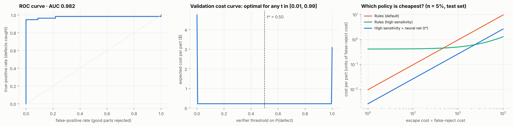

# Visual Defect Inspection: from computer vision to statistical decision-making

**Claire Chen** · end-to-end data science project in manufacturing quality control

A factory has to decide, part by part, whether a component has a **scratch**, **discoloration** or a **chip**, and has to be right in a way that makes business sense. This project covers the full path: a computer-vision baseline, machine-learning models I implemented from scratch, statistically careful model comparison, a cost-based decision analysis, and process monitoring.

📓 **Start here: [the analysis notebook](notebooks/analysis.ipynb)** walks through the whole study with code, figures and interpretation.

## Project at a glance

| Area | Details |
|---|---|
| **Problem** | Classify manufactured parts as PASS / FAIL and identify the defect type, balancing missed defects against scrapped good parts |
| **Data** | Simulated images with known ground truth: faint defects plus realistic look-alikes (dust, glare, tool marks); 400 images → 2,980 labelled patches |
| **Statistics** | Exploratory analysis, grouped train/test design (no leakage), cluster bootstrap CIs, McNemar's test, **repeated grouped cross-validation with the Nadeau–Bengio corrected t-test**, calibration (ECE), learning curves, **statistical process control (p-chart, Pareto)** |
| **Machine learning** | **Softmax regression** and a **neural network** written from scratch in NumPy (backpropagation, Adam, dropout, L2, early stopping, class weights), verified by gradient checking |
| **Business analysis** | ROC / PR curves, threshold chosen by **expected cost per part** at a realistic defect rate, saving with a bootstrap CI, and how the best policy changes with the cost of an escape |
| **Engineering** | Installable Python package, command-line tool, 37 automated tests, GitHub Actions CI |

## Key findings

1. **Tuning the rules' thresholds alone can't solve the problem.** Default thresholds pass 19% of defective parts; sensitive thresholds reject 43% of good parts.
2. **A learned verifier fixes the trade-off.** Sensitive rules followed by a neural-network check reach **96% accuracy with 0% good parts rejected** on held-out images.
3. **The better-looking model wasn't significantly better.** On engineered features, the neural network seemed to beat softmax regression (naive p = 0.01), but the **corrected cross-validation test gives p = 0.13**. On raw pixels, the neural network's advantage is large and real (p < 10⁻⁵).
4. **The decision is priced.** At a 5% defect rate, with an escape assumed to cost 20× a false reject, the verifier saves **$0.70 per part (95% CI $0.26–$1.23)** against the default rules. For safety-critical parts, where an escape costs a few hundred times more, catching everything becomes the cheaper policy.
5. **Process monitoring.** A p-chart on the inspector's output detects a simulated tool-wear shift within 4 batches, and the Pareto chart points to scratches as the cause.



## What's in the repository

| File | Contents |
|---|---|
| [`notebooks/analysis.ipynb`](notebooks/analysis.ipynb) | The full study: EDA → baseline → models → cross-validation → decision analysis → SPC |
| [`docs/ML_REPORT.md`](docs/ML_REPORT.md) | Technical write-up of the machine-learning verifier (maths, design, limitations) |
| [`src/defect_inspector/`](src/defect_inspector) | The package: computer-vision detectors, `ml/` (models, features, validation, decision analysis), `spc.py` |
| [`tests/`](tests) | 37 tests, including gradient checks and statistical-method tests |

---

## How the inspector works

Give it a photo of a part from your inspection station and it answers three questions:

| Question | Defect | How it is found |
|---|---|---|
| Does it have a **scratch**? | Thin line darker or brighter than the surface | Morphological top-hat / black-hat + elongation filter |
| Does it have **discoloration**? | Rust, heat tint, burn mark, stain | Colour distance (ΔE in CIE L\*a\*b\*) from the part's normal colour |
| Does it have a **chip**? | Material missing from the edge | Concavity of the part outline vs. its convex hull |

Each image gets a **PASS / FAIL** verdict, a per-defect list with location, size and severity, an annotated image for the operator, and JSON + CSV reports for traceability.


The core is classical computer vision (OpenCV + NumPy): no GPU, no training data required, ~40 ms per 512×512 image on a CPU, and every decision is explainable and tunable from one config file. An optional **machine-learning verifier** (softmax regression / neural network, implemented from scratch) can be added on top; see [below](#machine-learning-softmax-regression--neural-network-verifier).

---

## Quick start

```bash
git clone https://github.com/Clairechen163/visual-defect-inspection.git
cd visual-defect-inspection
pip install -e ".[dev]"

# 1. No factory images yet? Generate a labelled synthetic set
defect-inspect generate --n 100 --out data/synthetic

# 2. Inspect a single image or a whole folder
defect-inspect inspect data/synthetic/images --out results

# 3. Measure accuracy against labels
defect-inspect evaluate data/synthetic
```

Example output:

```
PASS    part_0000.png                  -                                     38.2 ms
FAIL    part_0001.png                  discoloration                         41.0 ms
FAIL    part_0002.png                  scratch, chip                         39.5 ms
...
100 inspected, 71 rejected. Report: results/report.json
```

`results/` contains:

- `annotated/*.png`: images with defects boxed (red = scratch, amber = discoloration, magenta = chip)
- `report.json`: full detail per image (bbox, area, severity, ΔE, chip depth, scratch length…)
- `report.csv`: one row per image: `verdict, scratch, discoloration, chip` flags, ready for Excel / MES upload

### Python API

```python
from defect_inspector import Inspector, load_image, annotate

inspector = Inspector()
result = inspector.inspect(load_image("part.jpg"))

print(result.verdict)          # "PASS" | "FAIL" | "NO_PART"
print(result.defect_types)     # e.g. {"scratch", "chip"}
for d in result.defects:
    print(d.type, d.bbox, d.severity, d.details)
```

### Line integration

`defect-inspect inspect <dir> --fail-exit` returns exit code `1` if any part fails, so a PLC script, reject gate or CI-style job can act on it directly.

---

## Accuracy (synthetic benchmark)

200 held-out synthetic images (seed 7), 30 % good parts, random combinations of 1–2 of each defect, disc and rectangular parts, brushed texture, uneven lighting:

| | Precision | Recall |
|---|---|---|
| Scratch | 1.00 | 0.98 |
| Discoloration | 1.00 | 0.99 |
| Chip | 1.00 | 1.00 |
| **PASS/FAIL** | accuracy **99.5 %** | escape rate 0.7 %, false-reject rate 0 % |

Reproduce with `defect-inspect generate --n 200 --seed 7 --out data/s7 && defect-inspect evaluate data/s7`. CI re-runs a fresh benchmark on every push.

> Synthetic numbers prove the pipeline works; they are **not** a guarantee on your parts. Before production, label a few hundred real images and run `evaluate` on them (see below).

---

## Machine learning: softmax regression & neural network verifier

Rules force a trade-off: strict thresholds miss faint defects, sensitive thresholds reject parts with harmless dust or glare. The `ml` module adds a learned **second stage**. The rules run at high sensitivity, and a classifier checks every candidate (*good / scratch / discoloration / chip*) and discards the false alarms.

Both models are written **from scratch in NumPy**. That includes softmax with cross-entropy, hand-written backpropagation, Adam, dropout, L2 regularisation, early stopping and class weighting. Both are checked against numerical gradients.

| Experiment (held-out test data) | Result |
|---|---|
| Softmax regression · 18 statistical features | 97.6% accuracy, macro-F1 0.95 |
| **Neural network · 18 statistical features** | **98.8% accuracy, macro-F1 0.98** |
| Softmax regression · raw pixels | 85.4% accuracy, macro-F1 0.65 |
| Neural network · raw pixels | 92.7% accuracy, macro-F1 0.82 |
| Inspector, rules only → **high-sensitivity rules + neural net verifier** | PASS/FAIL accuracy 86% → **96%**, good parts rejected **0%** |


Evaluation is done with care for the statistics: the data is **split by image** to prevent leakage, **cluster-bootstrap 95% CIs** are reported, models are compared with **McNemar's exact test**, and **calibration error** is measured. The full write-up, with method, maths, figures and limitations, is in **[docs/ML_REPORT.md](docs/ML_REPORT.md)**.

```bash
# Reproduce the whole experiment (~1 min on a laptop CPU)
defect-inspect train-ml data/hard --generate 400 --out models/run

# Re-run the full analysis notebook (~7 min)
jupyter nbconvert --to notebook --execute --inplace notebooks/analysis.ipynb

# Use the shipped verifier
defect-inspect inspect images/ --config configs/high_sensitivity.json --model models/mlp_features.npz
```

```python
from defect_inspector import Inspector, InspectionConfig, load_image
from defect_inspector.ml import PatchClassifier

inspector = Inspector(InspectionConfig.from_json("configs/high_sensitivity.json"),
                      classifier=PatchClassifier.load("models/mlp_features.npz"))
for d in inspector.inspect(load_image("part.jpg")).defects:
    print(d.type, d.details["ml_label"], d.details["ml_confidence"])
```

`defect-inspect generate` takes `--min-intensity 0.25` for faint defects and `--nuisance-rate 2` for dust, glare and tool marks, which together give a harder, more realistic dataset.

---

## Using it on your real parts

### 1. Imaging setup (matters more than the code)

- **One part per image**, fixed camera, fixed distance.
- **Contrasting, uniform background**: dark tray/conveyor for bright metal, or a backlight. The part is segmented automatically (light-on-dark or dark-on-light both work).
- **Diffuse, even lighting** (dome or ring light) to avoid glare that looks like scratches. Low-angle side light makes shallow scratches pop.
- Fixed exposure and white balance. Auto-exposure shifts colours and breaks discoloration detection.

### 2. Tune thresholds

```bash
defect-inspect config --out my_part.json   # dump the defaults, then edit
defect-inspect inspect images/ --config my_part.json
```

| Key | Effect | Raise it if… |
|---|---|---|
| `scratch_min_contrast`, `scratch_sigma` | How strong a line must be | texture / machining marks are flagged |
| `scratch_min_length_px`, `scratch_min_elongation` | Minimum scratch size/shape | short pits or dust are flagged as scratches |
| `discolor_delta_e` | Colour difference allowed | normal colour variation is flagged |
| `discolor_lightness_weight` | 1.0 = brightness counts fully, 0.5 = mostly hue | uneven lighting causes false rejects (lower it) |
| `discolor_min_area_px` | Smallest stain | small specks are flagged |
| `chip_min_depth_px`, `chip_min_depth_ratio` | Smallest chip depth | edge burrs/noise are flagged |
| `edge_margin_px` | Border ignored for surface checks | the part outline triggers scratches |

All pixel values scale with your camera resolution.

### 3. Validate with labelled data

Put real images in `my_set/images/` and write `my_set/labels.json`:

```json
{
  "img_001.jpg": [],
  "img_002.jpg": [{"type": "scratch", "bbox": [120, 88, 60, 14]}],
  "img_003.jpg": [{"type": "chip", "bbox": [301, 12, 25, 18]},
                  {"type": "discoloration", "bbox": [200, 200, 40, 35]}]
}
```

Then `defect-inspect evaluate my_set --config my_part.json --out eval.json`. The report lists precision/recall per defect type, escape rate (bad parts passed: the number your quality team cares about most) and every mismatched image so you can see what to tune.

---

## Project layout

```
src/defect_inspector/
  config.py       all thresholds (JSON load/save)
  preprocess.py   image loading, part segmentation
  detectors.py    scratch / discoloration / chip detectors
  inspector.py    pipeline → InspectionResult (PASS/FAIL + defects)
  visualize.py    annotated output images
  synth.py        synthetic labelled data generator
  evaluate.py     precision / recall / escape-rate scoring
  cli.py          `defect-inspect` command
  spc.py          statistical process control (p-chart) on inspector output
  ml/
    softmax.py    softmax regression (from scratch)
    mlp.py        neural network with hand-written backprop
    optim.py      softmax, cross-entropy, Adam
    features.py   18 interpretable patch statistics / raw-pixel input
    dataset.py    labelled patch extraction, split by image
    metrics.py    confusion matrix, bootstrap CI, McNemar, calibration
    classifier.py trained model + preprocessing, plugs into Inspector
    train.py      full experiment (`defect-inspect train-ml`)
    validation.py repeated grouped CV, corrected t-test, learning curves
    decision.py   ROC/PR, expected-cost threshold, bootstrap savings
    plots.py      report figures
models/           trained verifiers (softmax + neural net on features)
configs/          high_sensitivity.json for use with a verifier
docs/ML_REPORT.md machine-learning write-up
docs/figures/     figures produced by the notebook
notebooks/        analysis.ipynb (+ build_notebook.py that generates it)
tests/            pytest suite incl. gradient checks (runs on synthetic data)
.github/workflows CI: tests + accuracy benchmark
```

## Known limitations & roadmap

- **Chip detection assumes the part outline is convex** (discs, rectangles, rings, plates). Parts with designed-in notches or slots would need a golden-template comparison mode: register the part to a reference mask and flag missing area. This is the natural next feature.
- **One part per image.** Multi-part trays would need a loop over each blob in `segment_part`.
- **Interior holes** (washers) are filled during segmentation; inner-edge chips are not checked yet.
- **Highly textured or reflective surfaces** (cast, knurled, mirror-polished) may need more learning. Next steps are a CNN on full-resolution patches and unsupervised anomaly detection trained on good parts only (see [ML_REPORT.md §8](docs/ML_REPORT.md#8-next-steps)).

## License

MIT
