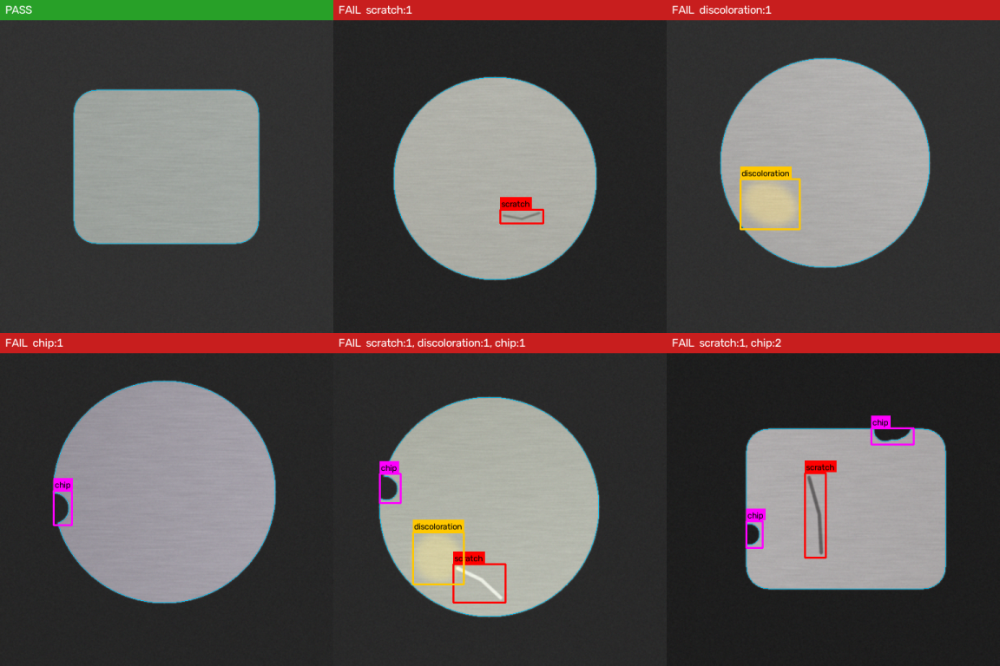

# Visual Defect Inspection

Automated visual inspection for manufactured parts. Give it a photo of a part from your inspection station and it answers three questions:

| Question | Defect | How it is found |
|---|---|---|
| Does it have a **scratch**? | Thin line darker or brighter than the surface | Morphological top-hat / black-hat + elongation filter |
| Does it have **discoloration**? | Rust, heat tint, burn mark, stain | Colour distance (ΔE in CIE L\*a\*b\*) from the part's normal colour |
| Does it have a **chip**? | Material missing from the edge | Concavity of the part outline vs. its convex hull |

Each image gets a **PASS / FAIL** verdict, a per-defect list with location, size and severity, an annotated image for the operator, and JSON + CSV reports for traceability.



It is classical computer vision (OpenCV + NumPy): no GPU, no training data required, ~40 ms per 512×512 image on a CPU, and every decision is explainable and tunable from one config file.

---

## Quick start

```bash
git clone https://github.com/<you>/visual-defect-inspection.git
cd visual-defect-inspection
pip install -e ".[dev]"

# 1. No factory images yet? Generate a labelled synthetic set
defect-inspect generate --n 100 --out data/synthetic

# 2. Inspect a single image or a whole folder
defect-inspect inspect data/synthetic/images --out results

# 3. Measure accuracy against labels
defect-inspect evaluate data/synthetic
```

Example output:

```
PASS    part_0000.png                  -                                     38.2 ms
FAIL    part_0001.png                  discoloration                         41.0 ms
FAIL    part_0002.png                  scratch, chip                         39.5 ms
...
100 inspected, 71 rejected. Report: results/report.json
```

`results/` contains:

- `annotated/*.png`: images with defects boxed (red = scratch, amber = discoloration, magenta = chip)
- `report.json`: full detail per image (bbox, area, severity, ΔE, chip depth, scratch length…)
- `report.csv`: one row per image: `verdict, scratch, discoloration, chip` flags, ready for Excel / MES upload

### Python API

```python
from defect_inspector import Inspector, load_image, annotate

inspector = Inspector()
result = inspector.inspect(load_image("part.jpg"))

print(result.verdict)          # "PASS" | "FAIL" | "NO_PART"
print(result.defect_types)     # e.g. {"scratch", "chip"}
for d in result.defects:
    print(d.type, d.bbox, d.severity, d.details)
```

### Line integration

`defect-inspect inspect <dir> --fail-exit` returns exit code `1` if any part fails, so a PLC script, reject gate or CI-style job can act on it directly.

---

## Accuracy (synthetic benchmark)

200 held-out synthetic images (seed 7), 30 % good parts, random combinations of 1–2 of each defect, disc and rectangular parts, brushed texture, uneven lighting:

| | Precision | Recall |
|---|---|---|
| Scratch | 1.00 | 0.98 |
| Discoloration | 1.00 | 0.99 |
| Chip | 1.00 | 1.00 |
| **PASS/FAIL** | accuracy **99.5 %** | escape rate 0.7 %, false-reject rate 0 % |

Reproduce with `defect-inspect generate --n 200 --seed 7 --out data/s7 && defect-inspect evaluate data/s7`. CI re-runs a fresh benchmark on every push.

> Synthetic numbers prove the pipeline works; they are **not** a guarantee on your parts. Before production, label a few hundred real images and run `evaluate` on them (see below).

---

## Using it on your real parts

### 1. Imaging setup (matters more than the code)

- **One part per image**, fixed camera, fixed distance.
- **Contrasting, uniform background**: dark tray/conveyor for bright metal, or a backlight. The part is segmented automatically (light-on-dark or dark-on-light both work).
- **Diffuse, even lighting** (dome or ring light) to avoid glare that looks like scratches. Low-angle side light makes shallow scratches pop.
- Fixed exposure and white balance. Auto-exposure shifts colours and breaks discoloration detection.

### 2. Tune thresholds

```bash
defect-inspect config --out my_part.json   # dump the defaults, then edit
defect-inspect inspect images/ --config my_part.json
```

| Key | Effect | Raise it if… |
|---|---|---|
| `scratch_min_contrast`, `scratch_sigma` | How strong a line must be | texture / machining marks are flagged |
| `scratch_min_length_px`, `scratch_min_elongation` | Minimum scratch size/shape | short pits or dust are flagged as scratches |
| `discolor_delta_e` | Colour difference allowed | normal colour variation is flagged |
| `discolor_lightness_weight` | 1.0 = brightness counts fully, 0.5 = mostly hue | uneven lighting causes false rejects (lower it) |
| `discolor_min_area_px` | Smallest stain | small specks are flagged |
| `chip_min_depth_px`, `chip_min_depth_ratio` | Smallest chip depth | edge burrs/noise are flagged |
| `edge_margin_px` | Border ignored for surface checks | the part outline triggers scratches |

All pixel values scale with your camera resolution.

### 3. Validate with labelled data

Put real images in `my_set/images/` and write `my_set/labels.json`:

```json
{
  "img_001.jpg": [],
  "img_002.jpg": [{"type": "scratch", "bbox": [120, 88, 60, 14]}],
  "img_003.jpg": [{"type": "chip", "bbox": [301, 12, 25, 18]},
                  {"type": "discoloration", "bbox": [200, 200, 40, 35]}]
}
```

Then `defect-inspect evaluate my_set --config my_part.json --out eval.json`. The report lists precision/recall per defect type, escape rate (bad parts passed: the number your quality team cares about most) and every mismatched image so you can see what to tune.

---

## Project layout

```
src/defect_inspector/
  config.py       all thresholds (JSON load/save)
  preprocess.py   image loading, part segmentation
  detectors.py    scratch / discoloration / chip detectors
  inspector.py    pipeline → InspectionResult (PASS/FAIL + defects)
  visualize.py    annotated output images
  synth.py        synthetic labelled data generator
  evaluate.py     precision / recall / escape-rate scoring
  cli.py          `defect-inspect` command
tests/            pytest suite (runs on synthetic data)
.github/workflows CI: tests + accuracy benchmark
```

## Known limitations & roadmap

- **Chip detection assumes the part outline is convex** (discs, rectangles, rings, plates). Parts with designed-in notches or slots would need a golden-template comparison mode: register the part to a reference mask and flag missing area. This is the natural next feature.
- **One part per image.** Multi-part trays would need a loop over each blob in `segment_part`.
- **Interior holes** (washers) are filled during segmentation; inner-edge chips are not checked yet.
- **Highly textured or reflective surfaces** (cast, knurled, mirror-polished) may need an anomaly-detection model instead of thresholds. The `Inspector` interface is designed so a learned detector (e.g. PatchCore / YOLO trained on your labelled set) can be added alongside the classical ones.

## License

MIT
