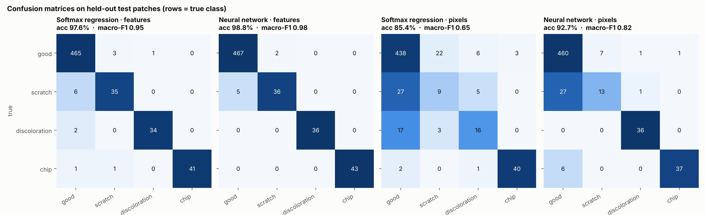
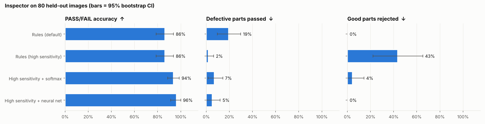
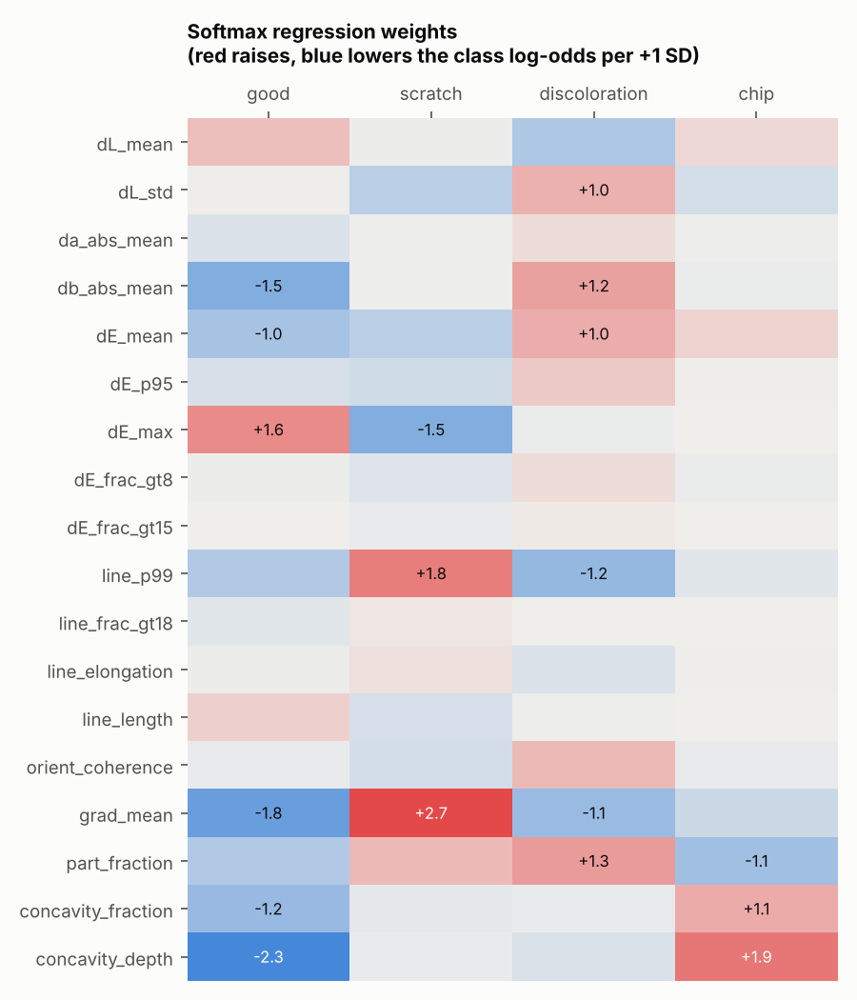
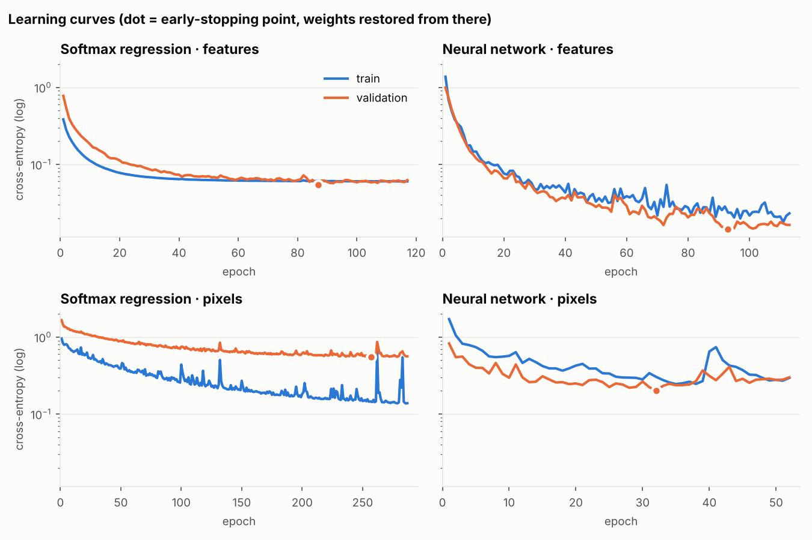

# Machine-learning verifier for visual defect inspection

**Question.** The rule-based inspector has to choose between missing faint defects and rejecting good parts. Can a learned classifier get the benefits of both? And how much model complexity does that take: is softmax regression enough, or do we need a neural network?

**Answer (synthetic data).** Running the rules at high sensitivity and adding a small neural network to verify each candidate gives **96% PASS/FAIL accuracy with 0% good parts rejected**. The default rules alone reach 86% and pass 19% of defective parts. With well-designed statistical features, a linear softmax model already comes close to the neural network. On raw pixels, the neural network is far better (macro-F1 0.82 vs 0.65), because the problem is not linear in pixel space.

Everything here is reproducible with one command:

```bash
defect-inspect train-ml data/hard --generate 400 --out models/run
```

---

## 1. Problem setup

A production line produces two kinds of error, and they don't cost the same:

| Error | Name | Cost |
|---|---|---|
| Defective part passed | **escape** (false negative) | customer complaint, recall |
| Good part rejected | **false reject** (false positive) | scrap, rework, lost throughput |

Lowering the rule thresholds reduces escapes but rejects harmless look-alikes: dust, specular glare, short machining marks. This project adds a second stage:

```
image ─► rule-based detectors (high sensitivity) ─► candidate regions
                                                       │  crop 64×64 patch
                                                       ▼
                                   classifier: good / scratch / discoloration / chip
                                                       │
                              "good" with p ≥ 0.5 ─► discard (false alarm)
                              otherwise          ─► keep defect, attach ml_label & confidence
```

## 2. Data

There are no labelled factory images yet, so `synth.py` generates them: 400 images, 30% of them good parts. Defect intensity is drawn from U(0.25, 1), which produces faint scratches, pale stains and small chips. Each image also gets Poisson(2) **nuisances**, harmless look-alikes labelled *good*. These hard negatives are what make the verifier necessary.

Patches (64×64) are cropped around every labelled defect, around every nuisance, and at random interior and **outline** points of the part. Sampling good patches on the outline stops a model from learning the shortcut "edge ⇒ chip".

| | good | scratch | discoloration | chip | total |
|---|---|---|---|---|---|
| patches | 2397 | 193 | 181 | 209 | 2980 |

**Split by image, not by patch (60/20/20 → 240/80/80 images).** Patches from the same image share lighting, texture and part geometry. A random patch-level split would put near-duplicates in both train and test and overstate accuracy. A test checks that no image appears in more than one split.

**Class imbalance** (80% good) is handled with balanced class weights $w_k = N / (K\,n_k)$ in the loss. Results are reported as **macro-F1**, which weights every class equally, alongside accuracy.

## 3. Representations

1. **18 statistical features** (`ml/features.py`), each designed to target one defect mechanism:
   * colour: mean/std of ΔL\*, |Δa\*|, |Δb\*|, and ΔE statistics (mean, p95, max, fraction > 8, > 15) relative to the part's median colour
   * line evidence: top-hat/black-hat response p99, fraction above threshold, elongation and length of the strongest line, gradient structure-tensor coherence, mean gradient
   * edge evidence: part coverage, and the area and depth of the gap between the silhouette and its convex hull (a convex part clipped by a square window stays convex, so any gap points to a chip)
2. **Raw pixels**: the patch converted to Lab, minus the part's median colour, masked to the part, downsampled to 24×24, plus the mask channel. That gives 2,304 inputs and no hand-crafted features.

All inputs are standardised using training-set mean and standard deviation only.

## 4. Models (NumPy, no ML framework)

### Softmax regression

$$P(y=k\mid x)=\frac{e^{w_k^\top x+b_k}}{\sum_j e^{w_j^\top x+b_j}},\qquad
\mathcal L=-\frac{1}{\sum_i w_{y_i}}\sum_i w_{y_i}\log P(y_i\mid x_i)+\frac{\lambda}{2}\lVert W\rVert^2$$

The gradient is $\nabla_W\mathcal L = X^\top(P-Y)\,/\,N + \lambda W$. This is the multiclass generalisation of logistic regression (a GLM with a multinomial response and logit link). Each weight therefore has an odds interpretation: one standard deviation more of feature $f$ multiplies the odds of class $k$ against class $j$ by $e^{w_{kf}-w_{jf}}$.

### Neural network (multi-layer perceptron)

`Linear → ReLU → Dropout` repeated, then `Linear → softmax`, with He initialisation, L2 weight decay and inverted dropout. Backpropagation is written out by hand in `ml/mlp.py`:

$$\delta_L = (P-Y)/N,\quad \nabla W_l = A_{l-1}^\top\delta_l+\lambda W_l,\quad
\delta_{l-1} = (\delta_l W_l^\top)\odot \mathbb 1[Z_{l-1}>0]\odot D_{l-1}$$

| Model | Architecture | Parameters |
|---|---|---|
| softmax · features | 18 → 4 | 76 |
| neural net · features | 18 → 64 → 32 → 4 | 3,428 |
| softmax · pixels | 2304 → 4 | 9,220 |
| neural net · pixels | 2304 → 128 → 64 → 4 | 303,556 |

All four models use mini-batch **Adam** with **early stopping**: training stops when validation loss hasn't improved for a set number of epochs, and the best weights are restored. Hyper-parameters were chosen on the validation split only; the test split was used once. **Correctness is verified by gradient checking:** analytic and finite-difference gradients agree to a relative error below 1e-8 (`tests/test_ml.py`). A second test shows that softmax regression cannot fit XOR while the network can.

## 5. Results

### 5.1 Patch classification (589 held-out test patches from 80 images)

| Model | Accuracy [95% CI] | Macro-F1 [95% CI] | ECE |
|---|---|---|---|
| Softmax · features | 97.6% [96.0, 98.9] | 0.949 [0.910, 0.977] | 0.029 |
| **Neural net · features** | **98.8% [97.7, 99.7]** | **0.976 [0.951, 0.995]** | **0.007** |
| Softmax · pixels | 85.4% [82.6, 88.2] | 0.647 [0.589, 0.702] | 0.063 |
| Neural net · pixels | 92.7% [90.1, 95.0] | 0.817 [0.767, 0.866] | 0.043 |

The CIs come from a **cluster bootstrap** that resamples whole images (2,000 resamples), because patches from one image are not independent. ECE is the expected calibration error: the average gap between predicted confidence and observed accuracy.



**McNemar's exact test.** This is a paired test on the same test patches; it only counts the patches where exactly one of the two models is right.

| Comparison | Only A right | Only B right | p-value |
|---|---|---|---|
| softmax vs neural net (features) | 0 | 7 | 0.016 |
| softmax vs neural net (pixels) | 11 | 54 | 6 × 10⁻⁸ |
| neural net: features vs pixels | 38 | 2 | 1.5 × 10⁻⁹ |

**Robustness check: repeated grouped cross-validation.** A single split can be lucky, and McNemar treats correlated patches as independent. So I repeated the comparison with **5-fold cross-validation, run twice**, with folds made of whole images (20 paired fold scores per model). I compared the models with the **Nadeau–Bengio corrected resampled t-test**, which widens the variance by $(1/J + n_{test}/n_{train})$ because training sets overlap between folds.

| Model | CV macro-F1 (mean ± SD) |
|---|---|
| Softmax · features | 0.973 ± 0.013 |
| Neural net · features | 0.982 ± 0.006 |
| Softmax · pixels | 0.662 ± 0.028 |
| Neural net · pixels | 0.824 ± 0.026 |

| Comparison | Δ macro-F1 | naive t-test p | **corrected p** |
|---|---|---|---|
| neural net − softmax (features) | +0.008 | 0.013 | **0.13** |
| neural net − softmax (pixels) | +0.162 | 4 × 10⁻⁸ | **8 × 10⁻⁶** |
| features − pixels (neural net) | +0.157 | 8 × 10⁻⁹ | **2 × 10⁻⁶** |

So **on features, the neural network's advantage is not statistically significant** once the dependence between folds is accounted for, even though the single-split McNemar test (p = 0.016) and the naive t-test said it was. The pixel-level conclusions hold under any test. Details are in [the analysis notebook](../notebooks/analysis.ipynb), §4.

### 5.2 The system-level question: does the inspector improve? (80 held-out test images)



| Setup | PASS/FAIL accuracy | Defective passed | Good rejected |
|---|---|---|---|
| Rules (default) | 86.3% [78.8, 93.8] | 19.3% | 0.0% |
| Rules (high sensitivity) | 86.3% [78.8, 93.8] | 1.8% | 43.5% |
| High sensitivity + softmax | 93.8% [88.8, 98.8] | 7.0% | 4.3% |
| **High sensitivity + neural net** | **96.3% [91.3, 100]** | **5.3%** | **0.0%** |

**Replication.** I also ran the shipped neural net verifier on an independently generated set (60 images, different seed). It scored 96.7% accuracy with 5.0% escapes and 0% false rejects, against 88.3% and 30% false rejects for the high-sensitivity rules alone.

## 6. Discussion

* **Feature engineering vs. representation learning.** With good features, the problem is close to linearly separable, and 76 softmax parameters get within about one point of accuracy of a 3,428-parameter network. On raw pixels, a linear model can't express "a thin line at any orientation", and its learning curve overfits clearly: training loss keeps falling while validation loss stays flat. The network learns some of that structure on its own, but still trails the engineered features. Scratches are the hardest class from pixels (recall 0.32), because a 1–3 px line almost disappears after 64 → 24 px downsampling. That points to a CNN at full resolution as the next step.
* **The weights make sense.**  In the softmax model, `concavity_depth` raises the *chip* log-odds and lowers *good*; mean gradient and line response drive *scratch*; chroma shift (`db_abs_mean`, `dE_mean`) drives *discoloration*. The model learned the same physics the rule-based detectors encode.
* **Calibration matters for deployment.** The verifier discards a candidate when P(good) ≥ 0.5, so probabilities, not just labels, need to be reliable. The feature network is well calibrated (ECE 0.007), so this threshold can be moved to trade escapes against false rejects in a predictable way.
* **Remaining escapes.** The verifier gives up a few escapes (1.8% → 5.3%) in exchange for removing 43 points of false rejects. These are real defect candidates that the model scored as *good*. On a real line, the threshold `ml_reject_prob` would be set to a target escape rate agreed with quality engineering.



## 7. Limitations

* **Synthetic data.** The generator's defect and nuisance models are simplifications, so these numbers show that the method works, not how well it will perform on a real line. The next step is a few hundred labelled real images in the same `labels.json` format.
* **The test set is small** (80 images), so the image-level CIs are wide (±5–8 points). The confidence intervals are reported so this is visible.
* **McNemar's test treats patches as independent pairs.** Patches from one image are correlated, so its p-values are optimistic. The repeated grouped cross-validation in §5.1 addresses this: the borderline features result (p = 0.016) does not survive the corrected test (p = 0.13), while the pixel results do.
* The verifier can only remove false alarms. It can't find defects the rules missed.

## 8. Next steps

1. A **convolutional neural network** (PyTorch) on full-resolution patches, compared against this baseline using the same split and the same tests.
2. **Threshold selection as a decision problem:** pick `ml_reject_prob` to minimise the expected cost $c_{esc}\cdot\text{escapes} + c_{fr}\cdot\text{false rejects}$, and plot the ROC / precision-recall curve.
3. **Domain shift:** train on synthetic data, fine-tune on a small real set, and measure how much real data is needed (a learning curve over sample size).
4. **Unsupervised anomaly detection** (autoencoder / PatchCore) using good parts only, since defects are rare in production.

## Reproduce

```bash
pip install -e ".[dev]"
defect-inspect train-ml data/hard --generate 400 --out models/run   # ~1 minute on a laptop CPU
defect-inspect evaluate data/hard --config configs/high_sensitivity.json --model models/run/mlp_features.npz
pytest -q tests/test_ml.py                                          # gradient checks etc.
```

Code: [`src/defect_inspector/ml/`](../src/defect_inspector/ml): `softmax.py`, `mlp.py`, `optim.py` (softmax, cross-entropy, Adam), `features.py`, `dataset.py`, `metrics.py` (bootstrap, McNemar, ECE), `validation.py` (grouped CV, corrected t-test, learning curves), `decision.py` (ROC/PR, cost-based threshold), `train.py`, `plots.py`.
